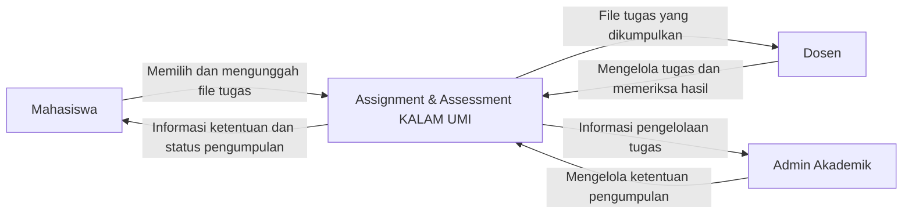
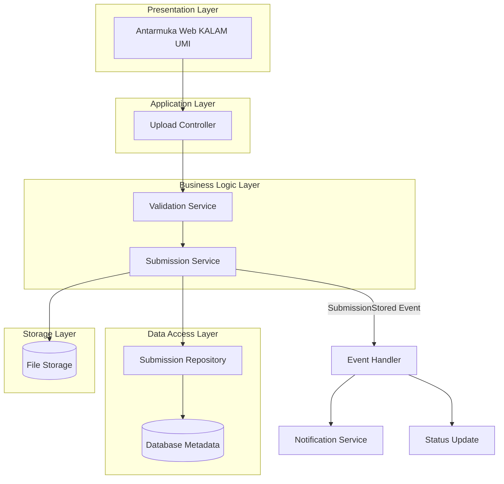
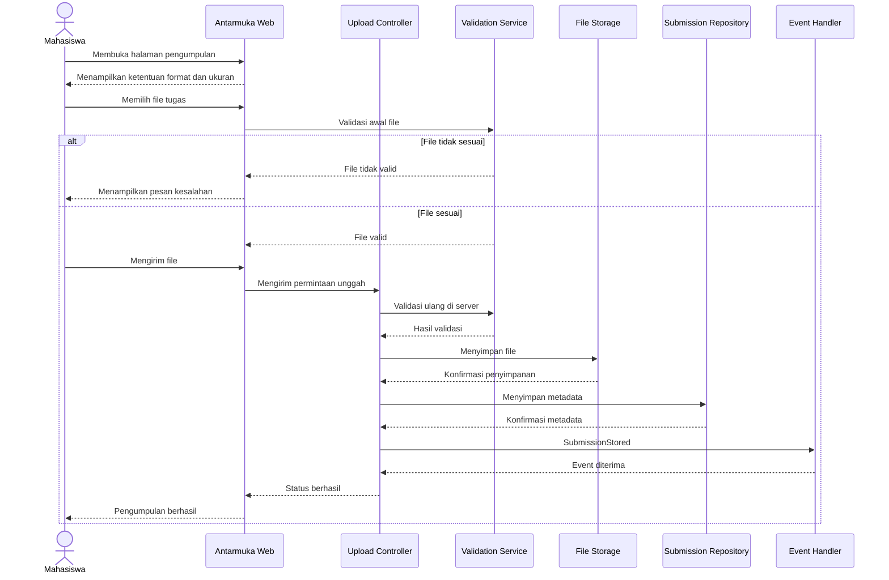

# LAPORAN UJIAN TENGAH SEMESTER
# ANALISIS DAN PERANCANGAN ARSITEKTUR PERANGKAT LUNAK

**Studi Kasus: Layanan Assignment & Assessment KALAM UMI**

---

## DAFTAR ISI

- [BAB I – Pendahuluan (U1)](#bab-i--pendahuluan-u1)
  - [1.1 Ringkasan Layanan](#11-ringkasan-layanan)
  - [1.2 Gambaran Layanan dan Batasan](#12-gambaran-layanan-dan-batasan)
  - [1.3 Masalah Utama yang Diusulkan](#13-masalah-utama-yang-diusulkan)
  - [1.4 Konteks Arsitektur](#14-konteks-arsitektur)
  - [1.5 Stakeholder](#15-stakeholder)
  - [1.6 Architecture Significant Requirements](#16-architecture-significant-requirements-asr)
  - [1.7 Tiga Karakteristik Pendorong](#17-tiga-karakteristik-pendorong)
  - [1.8 Pembaruan dari Tugas Sebelumnya](#18-pembaruan-dari-tugas-kelompok-sebelumnya)
- [BAB II – Skenario (U2)](#bab-ii--skenario-u2)
- [BAB III – Taktik dan Pola (U3–U4)](#bab-iii--taktik-dan-pola-u3u4)
- [BAB IV – Desain (U5)](#bab-iv--desain-u5)
- [BAB V – Evaluasi dan ADR (U6–U7)](#bab-v--evaluasi-dan-adr-u6u7)
- [BAB VI – Penutup](#bab-vi--penutup)
- [Daftar Pustaka](#daftar-pustaka)

---

# BAB I – PENDAHULUAN (U1)

## 1.1 Ringkasan Layanan

Assignment & Assessment merupakan layanan pada platform KALAM UMI yang mendukung proses pemberian tugas, pengumpulan tugas mahasiswa, penilaian oleh dosen, dan penyampaian umpan balik.

Mahasiswa dapat melihat informasi tugas dan mengumpulkan hasil pekerjaannya melalui sistem. Sementara itu, dosen dapat mengelola tugas, memeriksa hasil pengumpulan, memberikan nilai, serta menyampaikan umpan balik kepada mahasiswa.

Layanan ini berperan penting dalam mendukung proses pembelajaran secara digital di lingkungan Universitas Muslim Indonesia.

## 1.2 Gambaran Layanan dan Batasan

Assignment & Assessment mendukung interaksi antara mahasiswa dan dosen dalam aktivitas pemberian tugas, pengumpulan, dan penilaian.

Batas pembahasan laporan ini difokuskan pada proses pengumpulan file tugas, yang meliputi:

1. Menampilkan informasi dan ketentuan pengumpulan tugas.
2. Memilih file yang akan dikumpulkan.
3. Melakukan validasi format dan ukuran file.
4. Mengunggah dan menyimpan file.
5. Menyimpan metadata pengumpulan tugas.
6. Menampilkan konfirmasi hasil pengumpulan kepada mahasiswa.

Proses penilaian dosen hanya dibahas sebagai konteks penggunaan file yang telah berhasil dikumpulkan.

## 1.3 Masalah Utama yang Diusulkan

### Keterbatasan Format dan Ukuran File Tugas

Masalah utama yang diusulkan dalam laporan ini adalah keterbatasan format dan ukuran file ketika mahasiswa melakukan pengumpulan tugas melalui layanan Assignment & Assessment KALAM UMI.

Mahasiswa dapat mengalami kendala ketika mengumpulkan tugas apabila format file atau ukuran dokumen yang dimiliki tidak sesuai dengan ketentuan sistem.

Kondisi tersebut dapat menghambat proses pengumpulan tugas, terutama ketika mahasiswa harus mengubah format dokumen atau memperkecil ukuran file sebelum melakukan pengunggahan.

**Dampak permasalahan:**

1. Mahasiswa membutuhkan waktu tambahan untuk menyesuaikan format file.
2. Proses pengumpulan tugas menjadi lebih lambat.
3. Mahasiswa dapat mengalami kegagalan saat mengunggah file.
4. Terdapat risiko keterlambatan pengumpulan tugas.
5. Pengalaman pengguna dalam menggunakan sistem menjadi kurang optimal.

**Usulan solusi:**

1. Sistem menampilkan informasi format file yang diperbolehkan.
2. Sistem memberikan informasi batas ukuran maksimum file.
3. Sistem melakukan validasi format dan ukuran file sebelum penyimpanan.
4. Sistem memberikan pesan kesalahan yang jelas apabila file tidak sesuai.
5. Sistem menampilkan konfirmasi setelah file berhasil disimpan.

**Catatan:** Permasalahan ini merupakan fokus analisis yang diusulkan dan perlu divalidasi melalui observasi, tangkapan layar, atau wawancara. Bukan merupakan hasil pengukuran aktual sistem KALAM UMI.

## 1.4 Konteks Arsitektur

Analisis konteks arsitektur dilakukan melalui empat perspektif, yaitu bisnis, data, aplikasi, dan teknologi.

| Perspektif | Konteks |
|---|---|
| Bisnis | Mendukung pengumpulan tugas secara efektif, tepat waktu, dan sesuai ketentuan akademik. |
| Data | Mengelola nama file, format, ukuran, identitas mahasiswa, identitas tugas, waktu unggah, lokasi penyimpanan, dan status pengumpulan. |
| Aplikasi | Menyediakan tampilan ketentuan, pemilihan file, validasi, pengunggahan, konfirmasi, dan pesan kesalahan. |
| Teknologi | Memerlukan antarmuka web, server aplikasi, layanan validasi, basis data metadata, dan penyimpanan file yang terlindungi. |

## 1.5 Stakeholder

Stakeholder merupakan pihak-pihak yang terlibat atau memiliki kepentingan terhadap layanan Assignment & Assessment.

| No. | Stakeholder | Kebutuhan Utama | Ekspektasi Kualitas | Prioritas |
|---|---|---|---|---|
| 1 | Mahasiswa | Mengetahui ketentuan dan mengunggah file dengan mudah. | Usability, Reliability | Tinggi |
| 2 | Dosen | Menerima file yang dapat dibuka dan diperiksa. | Reliability, Compatibility | Tinggi |
| 3 | Admin Akademik | Mengelola ketentuan pengumpulan secara konsisten. | Usability, Maintainability | Sedang |
| 4 | Tim IT/Pengelola | Memvalidasi, mengamankan, dan menyimpan file. | Security, Performance, Reliability | Tinggi |

## 1.6 Architecture Significant Requirements (ASR)

Architecture Significant Requirements (ASR) merupakan kebutuhan sistem yang memiliki pengaruh penting terhadap keputusan dan rancangan arsitektur perangkat lunak.

| ID | Kebutuhan Signifikan Arsitektur | Alasan | Prioritas |
|---|---|---|---|
| ASR-01 | Sistem menampilkan format yang diperbolehkan dan batas ukuran file sebelum unggah. | Mengurangi kesalahan yang dapat dicegah sejak awal. | Tinggi |
| ASR-02 | Sistem memvalidasi format, tipe konten, dan ukuran file di sisi server sebelum menyimpan file. | Menjaga konsistensi aturan dan mencegah validasi hanya bergantung pada browser. | Tinggi |
| ASR-03 | Sistem menyampaikan hasil unggah secara jelas dan hanya menyatakan berhasil setelah file serta metadata tersimpan. | Meningkatkan kejelasan bagi pengguna dan konsistensi catatan pengumpulan. | Tinggi |

## 1.7 Tiga Karakteristik Pendorong

Tiga karakteristik kualitas yang menjadi pendorong utama dalam rancangan arsitektur ini adalah Usability, Performance, dan Reliability.

| Karakteristik | Definisi Operasional dalam Layanan | Hubungan dengan Masalah |
|---|---|---|
| Usability | Informasi format dan ukuran mudah ditemukan serta pesan kesalahan mudah dipahami. | Mahasiswa mengetahui ketentuan sebelum memilih file dan tahu cara memperbaiki kesalahan. |
| Performance | Pemeriksaan metadata file selesai dalam waktu yang ditargetkan. | Validasi tidak menambah waktu tunggu yang berlebihan. |
| Reliability | File valid tersimpan dan tercatat; file tidak valid ditolak; status sesuai hasil sebenarnya. | Mengurangi kegagalan dan ketidakpastian pengumpulan. |

## 1.8 Pembaruan dari Tugas Kelompok Sebelumnya

Laporan ini mengembangkan hasil tugas kelompok sebelumnya pada layanan Assignment & Assessment KALAM UMI.

Analisis konteks A1 yang meliputi perspektif bisnis, data, aplikasi, dan teknologi dipertahankan serta diarahkan pada alur pengunggahan file tugas.

Identifikasi karakteristik B1 dipertajam menjadi tiga karakteristik pendorong, yaitu:

1. Usability.
2. Performance.
3. Reliability.

Atribut kualitas terukur pada B2 dikembangkan menjadi skenario enam komponen pada U2. Fokus permasalahan dipusatkan pada keterbatasan format dan ukuran file tugas.

---

# BAB II – SKENARIO (U2)

Setiap skenario atribut kualitas berikut memiliki enam komponen, yaitu Source, Stimulus, Environment, Artifact, Response, dan Response Measure.

Angka yang digunakan merupakan target rancangan yang diusulkan untuk diuji, bukan hasil pengukuran aktual KALAM UMI.

## 2.1 Skenario 1 – Usability: Informasi Ketentuan File

| Komponen | Deskripsi |
|---|---|
| Source | Mahasiswa yang akan mengumpulkan tugas. |
| Stimulus | Mahasiswa membuka halaman pengumpulan tugas sebelum memilih file. |
| Environment | Kondisi operasi normal; mahasiswa telah masuk ke KALAM UMI dan membuka tugas yang aktif. |
| Artifact | Halaman Assignment & Assessment, khususnya area informasi dan kontrol unggah. |
| Response | Sistem menampilkan format yang diterima, batas ukuran maksimum, dan petunjuk singkat sebelum pemilihan atau pengiriman file. |
| Response Measure | Informasi ketentuan tampil pada 100% halaman unggah yang diuji. Pengguna uji dapat menemukan format dan batas ukuran dalam maksimal 10 detik. |

Skenario ini menjawab masalah utama secara preventif. Pengguna mengetahui ketentuan sebelum mengunggah sehingga dapat menghindari pemilihan file yang tidak sesuai.

## 2.2 Skenario 2 – Performance: Validasi Metadata

| Komponen | Deskripsi |
|---|---|
| Source | Mahasiswa memilih file untuk dikumpulkan. |
| Stimulus | Permintaan pemeriksaan awal terhadap ekstensi, tipe konten, dan ukuran file dikirim ke layanan validasi. |
| Environment | Kondisi operasi normal dengan ukuran file masih dalam batas konfigurasi dan beban layanan normal. |
| Artifact | Upload Controller dan Validation Service. |
| Response | Sistem memeriksa metadata file dan mengembalikan status valid atau tidak valid beserta alasan ringkas. |
| Response Measure | 95% permintaan validasi metadata selesai dalam waktu maksimal 2 detik (P95 ≤ 2 detik), diukur pada 100 permintaan uji dengan lingkungan dan ukuran file yang dicatat. |

## 2.3 Skenario 3 – Reliability: Konsistensi Penyimpanan

| Komponen | Deskripsi |
|---|---|
| Source | Mahasiswa mengirim file tugas; server menerima permintaan unggah. |
| Stimulus | File valid diunggah, atau file tidak sesuai dikirim untuk diuji. |
| Environment | Operasi normal dan simulasi kegagalan koneksi atau penyimpanan pada pengujian. |
| Artifact | Validation Service, File Storage Service, Submission Repository, dan status pengumpulan. |
| Response | File tidak valid ditolak. File valid disimpan dan metadata dicatat. Sistem menampilkan berhasil hanya setelah keduanya terkonfirmasi. Jika gagal, status gagal ditampilkan dan pengguna dapat mencoba kembali tanpa membuat catatan ganda. |
| Response Measure | 100% file uji yang melanggar aturan ditolak. 100% status berhasil hanya diberikan pada unggahan yang file dan metadatanya terverifikasi tersimpan. Tidak ada catatan pengumpulan ganda pada 100 percobaan uji ulang. |

## 2.4 Keterkaitan Skenario dengan ASR

| Skenario | ASR Terkait | Fokus |
|---|---|---|
| Usability | ASR-01 | Informasi ketentuan tampil sebelum unggah. |
| Performance | ASR-02 | Validasi berjalan cepat dan konsisten. |
| Reliability | ASR-02, ASR-03 | Penolakan file tidak sesuai dan konfirmasi penyimpanan yang benar. |

---

# BAB III – TAKTIK DAN POLA (U3–U4)

## 3.1 Taktik untuk Skenario Usability

**Taktik:** Visibility of System Status dan Informative Feedback.

Sistem menempatkan informasi format yang diterima dan batas ukuran file di dekat kontrol unggah. Informasi menggunakan satuan yang jelas, misalnya MB, serta menampilkan alasan penolakan yang spesifik.

Ketentuan yang ditampilkan diambil dari konfigurasi tugas agar informasi tetap konsisten dengan aturan validasi.

**Cara Kerja:**

1. Ketika halaman tugas dibuka, antarmuka meminta konfigurasi ketentuan tugas.
2. Sistem menampilkan format dan batas ukuran sebelum mahasiswa memilih file.
3. Apabila file tidak sesuai, sistem menampilkan penyebab kesalahan.
4. Sistem memberikan tindakan yang dapat dilakukan mahasiswa untuk memperbaiki kesalahan.

**Harga yang Dibayar:**

Ruang antarmuka bertambah dan konfigurasi ketentuan harus dipelihara. Jika aturan tugas berubah tetapi konfigurasi tidak diperbarui, informasi dapat menjadi tidak konsisten.

## 3.2 Taktik untuk Skenario Performance

**Taktik:** Early Validation dan Efficient Processing.

Pemeriksaan awal menggunakan metadata file, seperti ukuran, ekstensi, dan MIME type sebelum proses penyimpanan penuh dilakukan.

Pemeriksaan sisi klien dapat memberikan umpan balik dengan cepat, tetapi keputusan akhir tetap dilakukan di server.

**Cara Kerja:**

1. Antarmuka melakukan pemeriksaan ringan untuk kenyamanan pengguna.
2. Server menerima file yang diunggah.
3. Server memeriksa ulang ukuran dan tipe konten.
4. Sistem mengembalikan hasil validasi kepada pengguna.
5. Pengukuran P95 dilakukan pada lingkungan uji yang terdokumentasi.

**Harga yang Dibayar:**

Validasi di klien dan server dapat menyebabkan pemeriksaan berulang. Pemeriksaan metadata saja juga tidak membuktikan keamanan isi file, sehingga pemeriksaan tambahan mungkin diperlukan.

## 3.3 Taktik untuk Skenario Reliability

**Taktik:** Transaction/Consistency Management, Acknowledgement After Persistence, dan Retry-Safe Submission.

Sistem menyimpan file dan metadata menggunakan mekanisme yang menjaga agar status pengumpulan tidak dinyatakan berhasil sebelum kedua bagian tersebut terkonfirmasi.

Permintaan ulang diberi identitas atau Idempotency Key maupun mekanisme pemeriksaan agar tidak menghasilkan catatan pengumpulan ganda.

**Cara Kerja:**

1. File diterima ke lokasi penyimpanan sementara.
2. Sistem melakukan validasi file.
3. File yang valid dipindahkan atau ditetapkan ke penyimpanan final.
4. Metadata pengumpulan dicatat.
5. Sistem mengirim konfirmasi setelah penyimpanan dan pencatatan berhasil.
6. Jika proses gagal, sistem membersihkan file sementara atau menandai proses untuk pemulihan.

**Harga yang Dibayar:**

Implementasi menjadi lebih kompleks karena memerlukan pengelolaan file sementara, pencatatan status, dan proses pemulihan. Selain itu, terdapat tambahan operasi penyimpanan dan pengujian.

## 3.4 Pola Arsitektur yang Dipilih

### 3.4.1 Layered Architecture (Pola Struktural)

Layered Architecture merupakan pola arsitektur yang membagi sistem menjadi beberapa lapisan berdasarkan tanggung jawab masing-masing.

Dalam rancangan ini, lapisan terdiri atas:

1. Presentation Layer.
2. Application Layer.
3. Business Logic Layer.
4. Data Access Layer.
5. Storage Layer.

Antarmuka tidak mengakses penyimpanan secara langsung. Setiap permintaan diproses melalui lapisan aplikasi dan aturan bisnis.

**Alasan Pemilihan:**

Pemisahan tanggung jawab memudahkan perubahan aturan format dan ukuran file, pengujian validasi, serta pemeliharaan sistem.

**Kelebihan:**
- Struktur sistem mudah dipahami.
- Pengujian lebih terarah.
- Pemeliharaan lebih mudah.
- Tanggung jawab setiap lapisan lebih jelas.

**Kekurangan:**
- Permintaan melewati beberapa lapisan sehingga dapat menambah latensi.
- Lapisan yang terlalu ketat dapat membuat perubahan sederhana menjadi berulang.

### 3.4.2 Event-Driven Architecture (Pola Komunikasi)

Event-Driven Architecture menggunakan peristiwa atau event untuk mengomunikasikan kejadian antar komponen.

Setelah file berhasil disimpan, layanan dapat menerbitkan event `SubmissionStored` untuk memicu proses lanjutan seperti notifikasi atau pembaruan status.

**Alasan Pemilihan:**

Proses lanjutan tidak harus dijalankan secara langsung dalam jalur respons pengunggahan file.

**Kelebihan:**
- Komponen notifikasi lebih terpisah.
- Pemrosesan lanjutan dapat dikembangkan secara mandiri.
- Ketergantungan antarkomponen lebih rendah.

**Kekurangan:**
- Konsistensi akhir perlu dikelola.
- Pelacakan alur menjadi lebih sulit.
- Memerlukan mekanisme antrean atau event.
- Memerlukan penanganan event duplikat.

## 3.5 Perbedaan Gaya Arsitektur dan Pola

Gaya arsitektur merupakan pendekatan tingkat tinggi yang mengarahkan organisasi dan interaksi sistem secara luas.

Pola arsitektur merupakan solusi yang dapat digunakan kembali untuk menyelesaikan masalah desain tertentu dalam konteks tertentu.

Dalam laporan ini, Layered dan Event-Driven digunakan untuk menjelaskan struktur berlapis dan komunikasi berbasis peristiwa.

| Aspek | Layered Architecture | Event-Driven Architecture |
|---|---|---|
| Fokus | Pembagian tanggung jawab berdasarkan lapisan. | Komunikasi melalui event atau peristiwa. |
| Kelebihan | Mudah dipahami, diuji, dan dipelihara. | Komponen lanjutan lebih longgar keterikatannya. |
| Kekurangan | Potensi tambahan latensi dan lapisan berlebih. | Pelacakan, urutan, duplikasi, dan konsistensi event lebih kompleks. |
| Penerapan | Jalur utama unggah dan validasi. | Notifikasi atau proses lanjutan setelah unggah. |

---

# BAB IV – DESAIN (U5)

## 4.1 Diagram Konteks

Diagram konteks menggambarkan hubungan antara pengguna dengan layanan Assignment & Assessment KALAM UMI dalam proses pengumpulan tugas.

**Penjelasan:**

1. Mahasiswa mengakses layanan untuk melihat ketentuan dan mengumpulkan file tugas.
2. Sistem memberikan informasi mengenai format, ukuran, dan status pengumpulan.
3. Dosen mengelola tugas dan memeriksa hasil pengumpulan mahasiswa.
4. Admin akademik mengelola ketentuan pengumpulan tugas.

## 4.2 Diagram Arsitektur yang Menerapkan Pola

Diagram berikut menggambarkan penerapan Layered Architecture dan Event-Driven Architecture pada proses pengumpulan tugas.

**Penjelasan:**

1. Presentation Layer menampilkan halaman pengumpulan tugas kepada mahasiswa.
2. Application Layer menerima permintaan unggah melalui Upload Controller.
3. Business Logic Layer melakukan validasi dan mengatur proses pengumpulan.
4. Data Access Layer mengelola metadata pengumpulan tugas.
5. Storage Layer menyimpan file yang telah dinyatakan valid.
6. Event Handler menerima peristiwa SubmissionStored untuk menjalankan proses lanjutan.
7. Notification Service mengirimkan pemberitahuan setelah proses pengumpulan berhasil.

## 4.3 UML Sequence Diagram

Sequence Diagram menggambarkan urutan interaksi antara mahasiswa, antarmuka, server, layanan validasi, penyimpanan file, dan basis data.

**Penjelasan:**

1. Mahasiswa membuka halaman pengumpulan tugas.
2. Sistem menampilkan informasi format dan ukuran file.
3. Mahasiswa memilih file yang akan dikumpulkan.
4. Sistem melakukan validasi awal terhadap file.
5. Jika file tidak sesuai, sistem menampilkan pesan kesalahan.
6. Jika file sesuai, mahasiswa mengirim file ke server.
7. Server melakukan validasi ulang.
8. File disimpan ke File Storage.
9. Metadata pengumpulan disimpan ke basis data.
10. Setelah file dan metadata terkonfirmasi tersimpan, sistem memberikan status berhasil kepada mahasiswa.

## 4.4 Prinsip Desain yang Diterapkan

| Prinsip | Penerapan | Manfaat |
|---|---|---|
| Separation of Concerns | Antarmuka, aturan bisnis, akses data, dan penyimpanan dipisahkan. | Perubahan aturan lebih terlokalisasi dan pengujian lebih mudah. |
| Secure by Default | Validasi akhir dan pemeriksaan hak akses dilakukan di server; file disimpan pada lokasi yang tidak dapat diakses sembarang pengguna. | Mengurangi ketergantungan pada validasi browser dan membatasi akses. |
| Fail Clearly and Consistently | Sistem menyampaikan penyebab gagal dan hanya memberi status berhasil setelah penyimpanan terkonfirmasi. | Mengurangi ketidakpastian pengguna dan ketidaksesuaian status. |

---

# BAB V – EVALUASI DAN ADR (U6–U7)

## 5.1 Pohon Utilitas Mini

Pohon utilitas mini menghubungkan tujuan kualitas dengan skenario yang dapat diuji.

Prioritas dan tingkat kesulitan berikut merupakan penilaian rancangan awal, dengan H berarti tinggi dan S berarti sedang.

| Tujuan Kualitas | Skenario (Stimulus → Respons) | Prioritas | Kesulitan |
|---|---|---|---|
| Usability | Mahasiswa membuka halaman unggah → ketentuan format dan ukuran terlihat serta ditemukan dalam waktu ≤10 detik. | Tinggi | Rendah |
| Performance | Mahasiswa meminta validasi metadata → P95 waktu validasi ≤2 detik. | Tinggi | Sedang |
| Reliability | File valid/tidak valid diproses → file tidak valid ditolak dan status berhasil hanya diberikan setelah file dan metadata tersimpan. | Tinggi | Tinggi |

## 5.2 Trade-off Berbobot: Dua Alternatif

Dua alternatif dibandingkan untuk menentukan strategi validasi yang paling sesuai.

Skala penilaian menggunakan angka 1–5, dengan nilai 5 menunjukkan hasil paling baik.

Bobot ditetapkan berdasarkan fokus masalah:

- Reliability: 40%.
- Performance: 30%.
- Usability: 20%.
- Kesederhanaan implementasi: 10%.

Nilai akhir dihitung dengan menjumlahkan hasil perkalian bobot dan skor setiap kriteria.

| Kriteria | Bobot | A: Validasi Server Saja | B: Validasi Klien + Server |
|---|---:|---:|---:|
| Reliability | 0,40 | 5 | 5 |
| Performance | 0,30 | 3 | 4 |
| Usability | 0,20 | 3 | 5 |
| Kesederhanaan Implementasi | 0,10 | 4 | 3 |
| **Nilai Berbobot** | **1,00** | **4,00** | **4,40** |

**Perhitungan Alternatif A:**

(0,40 × 5) + (0,30 × 3) + (0,20 × 3) + (0,10 × 4) = **4,00**

**Perhitungan Alternatif B:**

(0,40 × 5) + (0,30 × 4) + (0,20 × 5) + (0,10 × 3) = **4,40**

**Hasil Evaluasi:**

Berdasarkan bobot dan skor asumsi tersebut, alternatif B dipilih, yaitu validasi awal di sisi klien dan validasi wajib di sisi server.

Validasi klien digunakan untuk memberikan umpan balik dengan cepat, sedangkan validasi server menjadi keputusan akhir untuk memastikan konsistensi dan keamanan.

Skor merupakan penilaian analitis tim, bukan hasil eksperimen.

## 5.3 Analisis ala ATAM

Analisis ATAM digunakan untuk mengidentifikasi risiko, non-risiko, sensitivity point, dan trade-off point pada rancangan arsitektur.

### A. Risiko (Risk)

**R-1: Perbedaan Aturan Validasi Klien dan Server**

Aturan validasi di sisi klien dan server dapat berbeda.

Dampak: Pengguna melihat file seolah-olah valid tetapi server menolaknya, atau sebaliknya.

Mitigasi:
- Menggunakan sumber aturan yang terpusat.
- Melakukan pengujian kesesuaian aturan validasi.
- Memastikan server menjadi otoritas validasi akhir.

**R-2: Ketidakkonsistenan Penyimpanan File dan Metadata**

Gangguan saat file tersimpan tetapi metadata belum tercatat, atau sebaliknya, dapat menghasilkan status yang tidak konsisten.

Dampak: Mahasiswa dapat menerima informasi pengumpulan yang tidak sesuai dengan kondisi penyimpanan sebenarnya.

Mitigasi:
- Menggunakan status proses.
- Menyediakan mekanisme pemulihan atau kompensasi.
- Memberikan konfirmasi setelah kedua langkah terverifikasi.

### B. Non-Risiko (Non-Risk)

**NR-1: Menampilkan Informasi Format dan Batas Ukuran Sebelum Unggah**

Menampilkan informasi format dan batas ukuran sebelum unggah merupakan keputusan berisiko rendah karena tidak mengubah data file dan dapat diuji langsung melalui pemeriksaan antarmuka.

Risiko utamanya adalah informasi tidak sinkron dengan aturan validasi.

Mitigasi dilakukan dengan mengambil ketentuan dari konfigurasi yang sama dengan validator.

### C. Sensitivity Point

**SP-1: Nilai Batas Ukuran Maksimum File**

Nilai batas ukuran maksimum file merupakan bagian penting dalam rancangan sistem.

Perubahan batas ukuran dapat memengaruhi:

1. Pengalaman mahasiswa.
2. Waktu transfer file.
3. Kebutuhan kapasitas penyimpanan.
4. Beban layanan aplikasi.

Oleh karena itu, nilai batas perlu dikonfigurasi berdasarkan jenis tugas atau kebijakan akademik dan diuji pada beban yang relevan.

### D. Trade-off Point

**TP-1: Validasi Ganda di Klien dan Server**

Validasi ganda di klien dan server meningkatkan usability dan memberikan respons awal yang lebih cepat.

Namun, pendekatan ini juga menambah kompleksitas sistem serta berpotensi menyebabkan pemeriksaan berulang.

Validasi server tetap wajib untuk menjaga konsistensi dan keamanan.

## 5.4 Apakah Masalah Utama Teratasi?

Rancangan arsitektur yang diusulkan menangani penyebab utama permasalahan keterbatasan format dan ukuran file tugas melalui beberapa pendekatan.

1. Ketentuan format dan ukuran file ditampilkan sebelum proses unggah.
2. Validasi dilakukan pada sisi klien dan server.
3. Pesan kesalahan menjelaskan tindakan yang perlu dilakukan mahasiswa.
4. File yang tidak sesuai dengan ketentuan akan ditolak.
5. Status berhasil hanya diberikan setelah file dan metadata terkonfirmasi tersimpan.

Dengan demikian, rancangan ini berpotensi mengurangi kegagalan pengunggahan file akibat ketidaksesuaian format dan ukuran.

Namun, masalah belum dapat dinyatakan terbukti selesai pada sistem KALAM UMI sebelum implementasi dan pengujian langsung dilakukan.

## 5.5 Architecture Decision Records (ADR)

### ADR-01 – Validasi Akhir pada Sisi Server

| Elemen | Isi |
|---|---|
| Title | Validasi Akhir Format, Tipe Konten, dan Ukuran File pada Sisi Server |
| Status | Accepted (keputusan usulan untuk rancangan laporan) |
| Context | Validasi pada browser dapat dilewati atau dimanipulasi. Layanan memerlukan pemeriksaan yang konsisten sebelum file disimpan. |
| Decision | Server menjadi otoritas validasi akhir untuk ekstensi, MIME/type konten, ukuran, dan aturan tugas. Validasi klien hanya untuk umpan balik awal. |
| Consequences | Positif: aturan lebih konsisten dan tidak bergantung pada browser. Negatif: terdapat proses pemeriksaan tambahan di server dan perlu pengelolaan aturan yang sama. |

### ADR-02 – Konfirmasi Setelah File dan Metadata Tersimpan

| Elemen | Isi |
|---|---|
| Title | Konfirmasi Pengumpulan Setelah Persistensi File dan Metadata |
| Status | Accepted (keputusan usulan untuk rancangan laporan) |
| Context | Status berhasil yang diberikan terlalu awal dapat membuat mahasiswa mengira tugas telah terkumpul padahal file atau metadata belum tersimpan. |
| Decision | Sistem hanya menampilkan status berhasil setelah penyimpanan file dan pencatatan metadata terverifikasi. Permintaan ulang harus aman dari pencatatan ganda. |
| Consequences | Positif: status pengumpulan lebih dapat dipercaya dan duplikasi berkurang. Negatif: alur penyimpanan lebih kompleks dan memerlukan penanganan kegagalan parsial. |

---

# BAB VI – PENUTUP

## 6.1 Kesimpulan

Laporan ini mengevaluasi rancangan arsitektur layanan Assignment & Assessment KALAM UMI dengan fokus pada permasalahan keterbatasan format dan ukuran file tugas.

Tiga karakteristik pendorong yang dipilih adalah Usability, Performance, dan Reliability, yang kemudian diturunkan menjadi tiga skenario terukur.

Rancangan mengusulkan taktik penampilan ketentuan dan umpan balik, validasi metadata yang efisien, serta penyimpanan dan konfirmasi yang konsisten.

Layered Architecture digunakan untuk memisahkan tanggung jawab setiap bagian sistem, sedangkan Event-Driven Architecture mendukung proses lanjutan yang tidak harus berada pada jalur utama pengunggahan.

Evaluasi awal memilih pendekatan validasi klien dan server berdasarkan hasil trade-off berbobot.

Secara konseptual, rancangan menjawab masalah utama melalui penyediaan informasi ketentuan, proses validasi, pesan kesalahan, dan konfirmasi penyimpanan.

Namun, keberhasilan aktual tetap harus dibuktikan melalui observasi, implementasi, dan pengujian langsung pada layanan KALAM UMI.

---

# DAFTAR PUSTAKA

[1] L. Bass, P. Clements, and R. Kazman, *Software Architecture in Practice*, 4th ed. Boston, MA, USA: Addison-Wesley, 2021.

[2] P. Clements et al., *Documenting Software Architectures: Views and Beyond*, 2nd ed. Boston, MA, USA: Addison-Wesley, 2010.

[3] ISO/IEC, *ISO/IEC 25010: Systems and Software Engineering—Systems and Software Quality Requirements and Evaluation (SQuaRE)—System and Software Quality Models*. Geneva, Switzerland: ISO, 2011.

[4] M. Fowler, *Patterns of Enterprise Application Architecture*. Boston, MA, USA: Addison-Wesley, 2002.

[5] F. Buschmann, R. Meunier, H. Rohnert, P. Sommerlad, and M. Stal, *Pattern-Oriented Software Architecture: A System of Patterns*. Chichester, U.K.: Wiley, 1996.

---

**Dokumen:** Laporan Ujian Tengah Semester  
**Mata Kuliah:** Analisis dan Perancangan Arsitektur Perangkat Lunak  
**Studi Kasus:** Assignment & Assessment KALAM UMI  
**Kelompok:** 8

